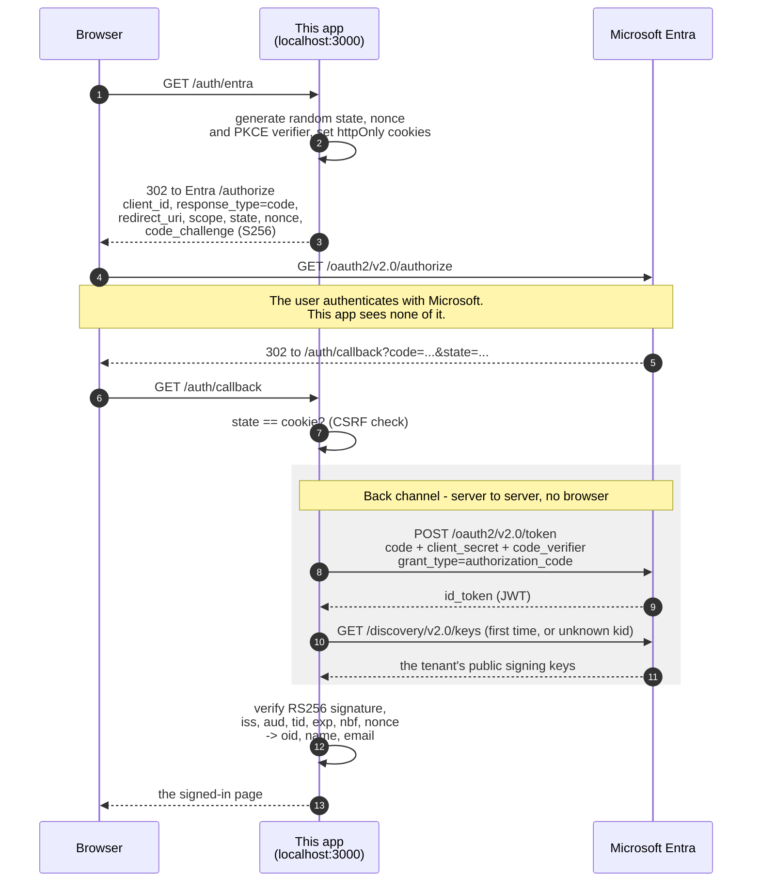

# entra-node-login-demo

Sign in with Microsoft Entra and show who signed in. One button, one redirect, one page of claims.

Node, not Spring Boot - deliberately, because it mirrors the prototype this was taken from and keeps
the OAuth flow visible rather than hidden behind framework configuration. Three routes, 134 lines,
two dependencies.

## What it does

1. `/` - a page with a **Sign in with Microsoft Entra** button
2. Cick on the sign in button and the browser is redirected to Entra
3. ( Entra handles the registration of user and sign in and then redirects back to /auth/callback )
4. /auth/callback` - the app receives a jwt that contains the user's **oid**, **name** and **email**
5. We display the contents of the jwt to the now signed in user

## Run it

Node 20.12 or later. Everything but the secret is defaulted to the HMCTS sandbox tenant, so:

```bash
cd entra-node-login-demo
npm install
export ENTRA_SIGNIN_CLIENT_SECRET=...     # from the sandbox app registration
npm start                          # http://localhost:3100
```

The secret is the only thing with no default, so it is the only thing that can be missing, and the
app refuses to start without it rather than failing later during the token exchange:

```
Cannot start: ENTRA_SIGNIN_CLIENT_SECRET is not set.

  export ENTRA_SIGNIN_CLIENT_SECRET=...   # from the Entra app registration
  npm start

Or read it from Key Vault: set ENTRA_KEY_VAULT and ENTRA_KEY_VAULT_SECRET (see .env.example).
```

**Export it. Do not put it in a file here** - exported values win over anything else, and a secret in
a file is a secret waiting to be committed.

### Settings in .env, the secret from Key Vault

To skip the exports, keep the settings in a gitignored `.env` and `npm start` reads the secret from
Key Vault on every start, with `DefaultAzureCredential` (`src/entra/secret.js`). It goes into the
app's environment only, never into `.env`, a file or a log.

```bash
az login                 # once; you need read access to the secret named in .env
cp .env.example .env     # web-api-marketplace's registration, https://localhost:3344
npm run cert             # once, because that redirect URI is https
npm start                # logs "secret 40 chars from Key Vault kvspsextidsbox/..."
```

`DefaultAzureCredential` is what makes the same code run anywhere. On a laptop it uses your `az login`
session; in AKS it uses the pod's workload identity - a managed identity, so there is no secret to
get the secret. For `web-api-marketplace` that identity, `apim-sandbox-mi`, is already a reader of
this secret in external-entra-id.

An exported `ENTRA_SIGNIN_CLIENT_SECRET` still wins, and so does anything else already exported over
`.env`. The client ID and `ENTRA_KEY_VAULT_SECRET` must belong to the same app registration, or Entra
answers `AADSTS7000215` (invalid client secret).

### Port 3100, and why

It matches the redirect URI registered on the sandbox app registration. Entra only redirects back to
an address registered there, so on another port sign-in fails with `AADSTS50011` before the user sees
a login form.

That is also the port `hmcts-api-marketplace`'s prototype-kit uses, so the two cannot run at once.
Either stop that one, or add `http://localhost:<other-port>/auth/callback` to the app registration's
redirect URIs and set `PORT` to match.

### Pointing it at a different tenant

Every default can be overridden from the environment: `ENTRA_SIGNIN_CLIENT_ID`, `ENTRA_TENANT_ID`,
`ENTRA_AUTHORIZE_ENDPOINT`, `ENTRA_TOKEN_ENDPOINT`, `ENTRA_JWKS_URI`, `ENTRA_ISSUER`,
`ENTRA_REDIRECT_URI`, `PORT`. The endpoints, `jwks_uri` and `issuer` all come from the tenant's
`/v2.0/.well-known/openid-configuration`. Note that External ID's `issuer` is on the tenant-ID
subdomain (`https://<tenant-id>.ciamlogin.com/<tenant-id>/v2.0`), not the friendly host.

## What it logs

Each route as it is hit, then the claims:

```
-> GET /auth/entra
   redirecting to Entra  state=de349f5f...  prompt=none
-> GET /auth/callback
   back from Entra  code=present  state=de349f5f...  error=none
   token exchange ok
   id token valid
   claims  oid=11111111-2222-3333-4444-555555555555  name=Ada Lovelace  email=ada@example.net
```

The same `state` either side is the CSRF check passing, and the quickest way to see a failed sign-in
for what it is. Three things are deliberately absent: the request path is logged without its query
string, because the callback's carries the authorization code; the code is logged as `present` or
`MISSING` rather than by value; and the ID token is never logged at all, only the claims read out of
it.

## The flow



Three things are worth knowing before the detail:

1. **The user's password never reaches this application.** They type it on Microsoft's own pages.
   This app never sees it, never stores it, and could not leak it.
2. **The browser never carries a token.** It carries a short-lived, single-use *authorization code*.
   The JWT is fetched separately, server to server. This distinction is the whole security design,
   and it is the thing most often misread.
3. **Entra knows who you are, and nothing else.** It holds `oid`, name, email and the credential. It
   has no concept of organisation, role, team or ownership - those belong in our database, keyed by `oid`.

## Two channels

**Front channel** - through the browser, visible in the address bar, in history, in any proxy log.
It carries only the authorization code.

**Back channel** - a direct HTTPS request from the Node process to Microsoft. It carries the token.

`response_type=code` is what selects this. The alternative, the old implicit flow
(`response_type=token`), returned the token itself into the browser's URL, where it would land in
browser history, server logs and `Referer` headers. The authorization code flow exists to avoid
that, and it is why the code arriving at `/auth/callback` is useless to anyone who steals it:
redeeming it also needs the client secret, which only the server has, and the PKCE verifier, which
only the browser that started the sign-in has.

## Step by step

### `/auth/entra` - starting the flow

Generates three random 32-byte values - `state`, `nonce` and a PKCE `code_verifier` - stores each
in an `httpOnly` cookie that lives ten minutes, and redirects to the tenant's authorize endpoint
with `client_id`, `response_type=code`, `redirect_uri`, `scope=openid profile email`, `state`,
`nonce`, and `code_challenge` (the SHA-256 of the verifier) with `code_challenge_method=S256`.

Each one defends against something different:

| Value | Sent to Entra | Checked | Stops |
|---|---|---|---|
| `state` | as is | on the callback, against the cookie | CSRF: a callback this browser never started |
| `code_verifier` | only its hash | by Entra, when the code is redeemed | a stolen or injected code being redeemed |
| `nonce` | as is | in the ID token, against the cookie | a token from another sign-in being replayed in |

`state` matters because the callback is a plain GET that anyone can navigate a victim's browser to;
the cookie is what proves *this browser* started *this* flow.

`?prompt=login` is allow-listed for local demos: it makes Microsoft show its form even when the
browser already has a session, which is otherwise why sign-in appears to "just work" with no way to
try a different account.

### `/auth/callback` - the code comes back

Microsoft redirects the browser back with `?code=...&state=...`, or `?error=...`. Before anything
else: no `error`, `state` matches the cookie, and there is a `code`. The three flow cookies are
then cleared, so the round trip cannot be replayed.

Note what has *not* happened yet. At this point the app has a code and nothing else - no token, no
claims, no idea who the user is.

### Redeeming the code

A server-side `POST` to the token endpoint with `grant_type=authorization_code`, carrying the code,
the `redirect_uri` it was issued for, the client secret and the PKCE `code_verifier`. Entra hashes
the verifier and refuses the code unless it matches the challenge it was given at the start.
**This is where the JWT arrives** -
`id_token` in the response body, over TLS, direct from Microsoft to the Node process.

### Checking the token, then reading the claims

A JWT is three base64url segments separated by dots: `header.payload.signature`. Decoding the
payload is trivial - and a decoded-but-unverified JWT is forgeable by anyone who can type base64. So
`entra/id-token.js` checks it first, using only Node's built-in `crypto`:

1. **`alg` is `RS256`** - pinned, never taken from the token, so `alg: none` or an HMAC trick is refused.
2. **The signature verifies** against the tenant's public key named by the header's `kid`, fetched
   from `jwks_uri` (`/discovery/v2.0/keys`) and cached. An unknown `kid` triggers one refetch,
   because Entra rotates its keys.
3. **`iss`** is this tenant's issuer, **`aud`** is this app's client ID, **`tid`** is this tenant.
4. **`exp`** has not passed and **`nbf`** has, with five minutes' allowance for clock skew.
5. **`nonce`** matches the cookie set when this sign-in started.

Any failure is a `401 ID token rejected` naming the check. Only then are `oid`, `name` and `email`
read - `email` falling back to `emails[0]`, because External ID returns an array in some
configurations.

Strictly, OIDC lets a confidential client skip the signature check for a token taken straight off
a TLS connection to the token endpoint. Checking anyway costs one cached fetch, and it means the
same code is safe to reuse wherever a token comes from.

## What `oid` is

**Object ID** - the GUID of the user's object in the Entra directory. The primary key of the row
representing that human in the tenant.

| Property | Consequence |
|---|---|
| **Immutable** | Never changes for the life of the account |
| **Survives rename** | Name change, email change - same `oid` |
| **Tenant-wide** | Every application in the tenant sees the *same* `oid` for the same person |

### `oid` vs `sub`

An ID token carries both, and they are not interchangeable. `sub` is also a stable identifier, but
it is **pairwise** - derived per `(user, application)`. The same person signing into two
applications in the same tenant gets two *different* `sub` values. That is deliberate: it stops two
applications correlating their users by comparing identifiers.

`oid` is the opposite: the same value everywhere in the tenant. That makes it the right thing to key
your own data on - not email, which changes, and not `sub`, which a second service would compute
differently for the same person.

## What a real integration must change

This demo shows the flow. Some things are deliberately not production-shaped:

1. **Carry identity in a real session.** This demo renders the claims and forgets them, which is why
   it needs no session at all. Anything that keeps a user signed in needs one - and it should hold
   the `oid`, not the name or email.
2. **Use a maintained library** rather than hand-rolled PKCE, nonce and JWT checks: MSAL
   (`@azure/msal-node`, as `web-api-marketplace` uses) in Node, or `spring-boot-starter-oauth2-client`
   in Spring Boot. Both do all of it for you.
3. **Prefer a certificate or federated credential** to a client secret.

This demo hand-rolls the steps precisely so they are visible.

## The tests

`npm test` uses Node's built-in test runner, with [supertest](https://github.com/ladjs/supertest) to
drive the app. Entra is a stub HTTP server on an ephemeral port rather than a mocked `fetch`: it
signs real RS256 tokens and publishes its key, so the real requests and the real signature check are
exercised.

They cover the round trip as a browser performs it - start at `/auth/entra`, carry the cookies, come
back with the code - including that the PKCE verifier sent to the token endpoint hashes to the
challenge sent to `/authorize`. Then the refusals: a `state` that does not match the cookie, no
cookie at all, no code, an `error` from Entra, and an ID token spoiled in each of eleven ways - wrong
nonce, no nonce, wrong `aud`, `iss` or `tid`, expired, not yet valid, signed by another key, an
unknown `kid`, `alg: none`, and a tampered payload.

## Not in the CI matrix

`.github/workflows/run-tests.yml` runs `./gradlew clean test` in each module it lists. This module
has no Gradle build, so adding it there would fail. It has no tests to run.
